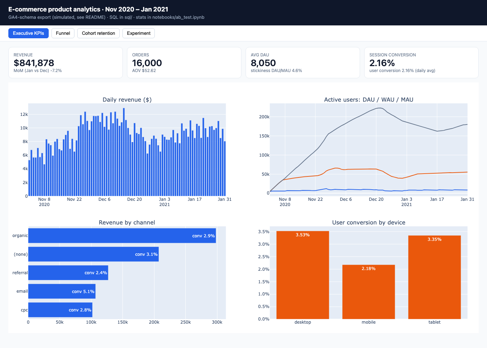
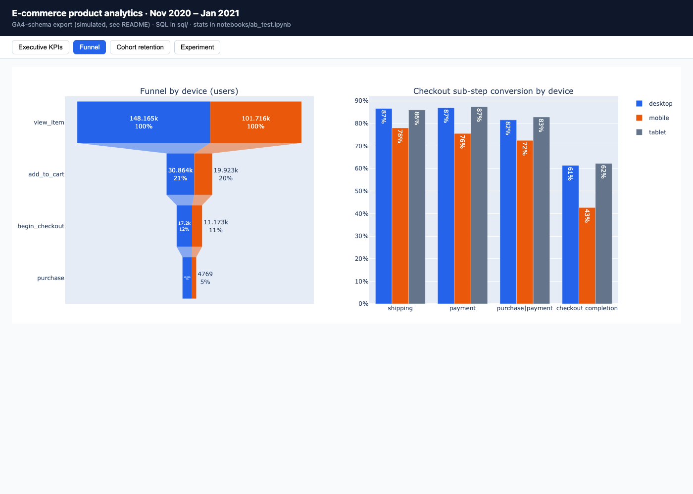
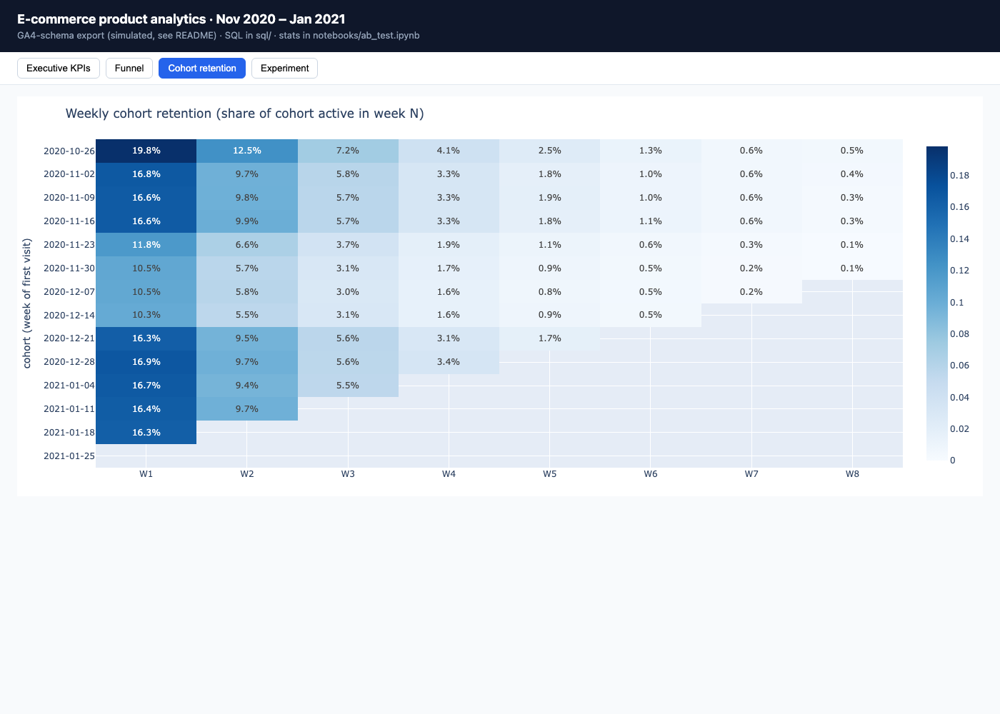
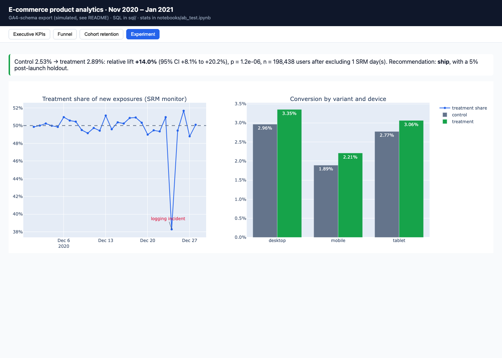

# product-analytics-ab-testing

End-to-end product analytics for an e-commerce store: **KPIs, funnel, cohort retention and RFM in
SQL (BigQuery dialect, window functions + CTEs)**, a properly evaluated **A/B test** in Python
(sanity checks, chi-square, two-proportion z-test, CIs, power, novelty, segments), a **4-page
dashboard** with a **Power BI** model/DAX kit, and a one-page **stakeholder memo**.

> **Start with [REPORT.md](REPORT.md)** (the memo), then [notebooks/ab_test.ipynb](notebooks/ab_test.ipynb).
> New to analytics? [docs/START_HERE.md](docs/START_HERE.md) → [docs/STUDY_TOPICS.md](docs/STUDY_TOPICS.md).



## Headline results

| | Result |
|---|---|
| A/B test: one-page checkout | **+14.0% relative lift** in purchase conversion (2.53% → 2.89%, 95% CI +8.1% to +20.2%, p = 1.2×10⁻⁶, n = 198k users) → **ship with a 5% holdout** |
| Guardrail | revenue per exposed user +$0.16 (95% bootstrap CI +$0.06 to +$0.26); AOV unchanged |
| Data-quality catch | overall SRM check **passed** (p = 0.32), but a **daily** SRM check found a treatment-logging outage on 24 Dec (38% vs 50% share, p ≈ 10⁻⁴⁰) → those users excluded |
| Insight 1 | mobile checkout completion **43% vs 61%** on desktop (an 18-point gap) |
| Insight 2 | email: 7% of users, **13% of revenue**, 5.1% conversion vs 2.9% organic |
| Insight 3 | holiday-sale cohorts' week-1 retention **10–12% vs ~16.5%** for other cohorts (about 35% lower) |
| Insight 4 | RFM "Champions": 16% of purchasers, **30% of revenue** |

## The data (read this)

The PRD suggests Google's public **GA4 e-commerce sample** in BigQuery. Querying it needs a GCP
project, so this repo ships a **seeded simulator** ([simulate/generate_ga4.py](simulate/generate_ga4.py))
that produces the **same schema** (sharded `events_YYYYMMDD` tables with nested `event_params`,
`device`, `geo`, `traffic_source`, `ecommerce`, `items`) over the **same period** (Nov 2020 – Jan
2021) at the **same scale** (4.26M events vs ~4.3M). The PRD allows simulating the experiment on GA4
users, and that's what's done here: a 4-week user-level test with realistic problems injected
(duplicate hits, users logged in both variants, a one-day logging outage).

* **Every `.sql` file is written in BigQuery Standard SQL against the real public table.** Locally
  it's transpiled to DuckDB with `sqlglot` and run on the simulated shards. To reproduce on real
  data, paste `sql/*.sql` into the BigQuery console (`make bigquery Q=04_funnel` prints one).
* Because the data is simulated, the ground truth is known. The notebook's appendix shows the
  analysis **recovers the planted effects** (every true lift falls inside its 95% CI). It also shows
  honestly what it could *not* recover (a novelty decay the test was underpowered to see).

## What's here

```
sql/                  BigQuery SQL, each file opens with the business question it answers
  00_data_quality     nulls, duplicates, transaction integrity, outliers
  01_kpis_active_users  DAU / WAU / MAU / stickiness (rolling distinct counts)
  02_kpis_daily       sessions, orders, revenue, conversion, AOV
  03_revenue_by_segment  channel / device / country (QUALIFY + window ranking)
  04_funnel, 05_funnel_by_segment  view → cart → checkout → purchase, drop-off per step & segment
  06_cohort_retention weekly first-visit cohorts × week-N retention
  07_rfm              RFM scores with NTILE → named segments
  08_experiment_extract  one row per exposed user (variant, contamination flags, converted, revenue)
  09_star_schema      user-day fact table for the BI model
notebooks/ab_test.ipynb  the A/B analysis (source: ab_test.py, jupytext)
analytics/            run_sql (BigQuery→DuckDB), stats (tested), build_model, build_dashboard
powerbi/              DAX measures, model + page build guide, theme (see "Power BI" below)
dashboard/index.html  4-page interactive dashboard (open in a browser)
data/processed/       extracted CSVs (the regenerable 59 MB star table is git-ignored)
REPORT.md             stakeholder memo
docs/                 study guides, decisions, interview prep
```

## Quick start

```bash
make install     # venv + pinned requirements
make all         # simulate data → run all SQL → Power BI CSVs → execute notebook → dashboard (~5 min)
open dashboard/index.html
make test        # 18 tests: stats vs statsmodels/SciPy + every SQL file on a small dataset
```

## Power BI

A `.pbix` can only be authored in Power BI Desktop (Windows), and this repo was built on macOS.
Provided instead: the **star-schema CSVs** (`make model`), **all DAX measures**
([powerbi/measures.dax](powerbi/measures.dax): conversion, AOV, DAU/WAU/MAU, stickiness, MoM
growth, funnel rates, cohort retention, experiment lift/z), the **theme**, and a
**step-by-step page build guide** ([powerbi/MODEL.md](powerbi/MODEL.md)). The Plotly dashboard
implements the same four pages. After building the `.pbix` from the guide, commit it with its
PDF export.

| Funnel | Cohorts | Experiment |
|---|---|---|
|  |  |  |

## Docs

[START_HERE](docs/START_HERE.md) · [STUDY_TOPICS](docs/STUDY_TOPICS.md) ·
[CONCEPTS](docs/CONCEPTS.md) · [ANALYSIS_TOUR](docs/ANALYSIS_TOUR.md) ·
[DECISIONS](docs/DECISIONS.md) · [LEARNING_GUIDE](docs/LEARNING_GUIDE.md) ·
[RUNBOOK](docs/RUNBOOK.md) · [RESUME_BULLETS](docs/RESUME_BULLETS.md)

## License
MIT
